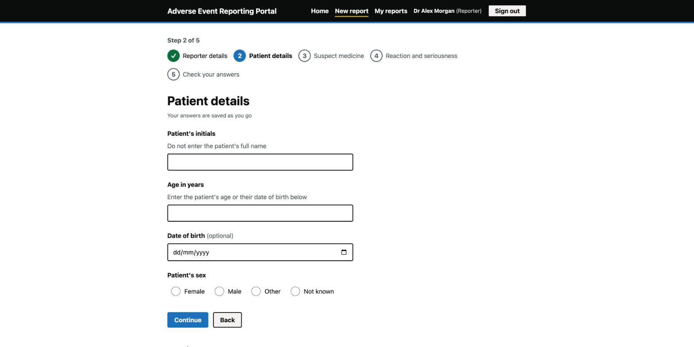
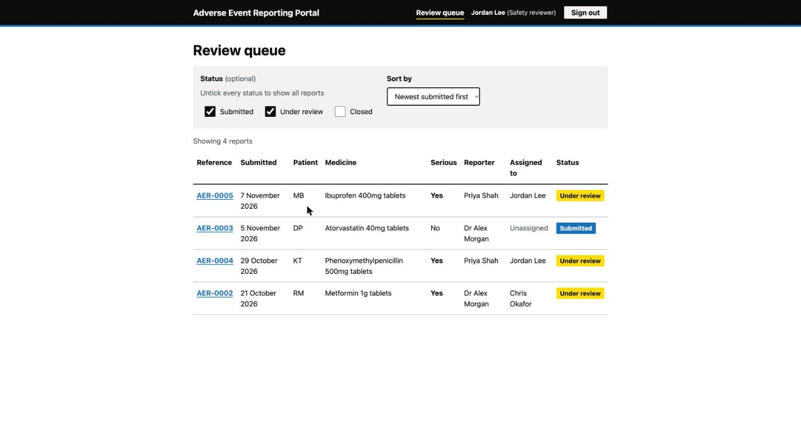
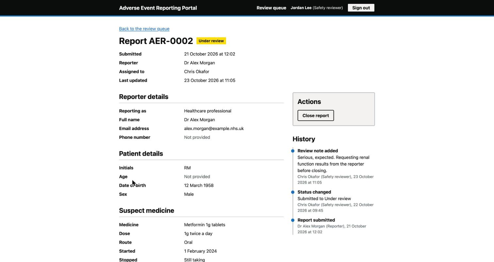

# Adverse Event Reporting Portal

**Live demo: https://adverse-event-portal.vercel.app**

A demonstration portal for reporting suspected adverse drug reactions, modelled on the UK MHRA Yellow Card scheme. Reporters submit through a guided, autosaving multi-step form. Safety reviewers work a filterable queue, change status, add notes and see a full audit trail of every action.

It is a front-end demonstration: the REST API and the single sign-on identity provider are mocked in the browser, so the whole thing runs locally with no backend.

| The guided form                                                                                     | The review queue                                                                                 | A report under review                                                                      |
| --------------------------------------------------------------------------------------------------- | ------------------------------------------------------------------------------------------------ | ------------------------------------------------------------------------------------------ |
|  |  |  |

## What it demonstrates

- A five-step form with conditional questions, per-step validation, an error summary that links to each field, autosave with "continue where you left off", and a check-your-answers step.
- Role-aware UI for three roles, enforced at the route, in the components, and in the (mocked) API.
- An OIDC authorization code sign-in flow shaped like a PingFederate integration, with the identity provider stood in by a page in this app. See [docs/sso.md](docs/sso.md).
- A small design system of tokens and accessible primitives, influenced by the GOV.UK Design System. See [docs/design-system.md](docs/design-system.md).
- WCAG 2.1 AA: keyboard operation, focus management between steps, errors linked and announced, contrast checked, axe run on every page in the tests.
- A typed REST client with TanStack Query over a Mock Service Worker API, intercepted in the page, that persists to localStorage.
- Tests at every level, CI on every pull request, and a pull-request-per-phase history that records how AI-generated code was reviewed. See [docs/ai-assisted-development.md](docs/ai-assisted-development.md).

## Live demo

https://adverse-event-portal.vercel.app

Deployed on Vercel from this repository: every pull request gets a preview URL and main is production. Sign in with any of the demo accounts below. The mock API runs in your browser, so each visitor has their own data and nothing is shared or stored anywhere else.

## Getting started

Requires Node 22.

```
npm install
npm run dev
```

Open the URL Vite prints, usually http://localhost:5173. You will be sent to the sign-in page. "Sign in with single sign-on" takes you to the demo identity provider, where you choose an account.

### Demo accounts

| Account        | Role            | Can do                                                    |
| -------------- | --------------- | --------------------------------------------------------- |
| Dr Alex Morgan | Reporter        | Start, autosave and submit reports; see their own reports |
| Priya Shah     | Reporter        | As above, with a separate set of reports                  |
| Jordan Lee     | Safety reviewer | Work the queue, start and close reviews, add notes        |
| Chris Okafor   | Safety reviewer | As above                                                  |
| Sam Patel      | Administrator   | Everything a reviewer can do, plus reassign reports       |

### Seed data

Six reports load on first run, spread across the three reporters' and reviewers' work: two awaiting review, two under review, two closed, with notes and audit history including one reassignment. Everything you do is saved to localStorage. To start again, clear site data for the origin, or run this in the browser console:

```
localStorage.clear()
```

## Scripts

| Command                  | Purpose                                        |
| ------------------------ | ---------------------------------------------- |
| `npm run dev`            | Start the dev server                           |
| `npm run build`          | Typecheck and production build                 |
| `npm run preview`        | Serve the production build                     |
| `npm run lint`           | ESLint, including jsx-a11y rules               |
| `npm run typecheck`      | TypeScript, strict                             |
| `npm test`               | Vitest, single run                             |
| `npm run test:watch`     | Vitest, watch mode                             |
| `npm run test:coverage`  | Vitest with coverage                           |
| `npm run check:contrast` | Contrast ratios of every colour pairing in use |
| `npm run format`         | Prettier                                       |

CI runs lint, typecheck, test and build on every pull request; main is protected and requires it.

## Project structure

```
src/
  api/            REST client and TanStack Query hooks
  auth/           Session, ID token handling and the OIDC client flow
  components/     Design system primitives, each with CSS Module and tests
  domain/         The report model and its label maps
  features/
    report-form/  Step schemas, draft storage, the form container and steps
    review/       Actions, notes and history for the reviewer
  mocks/          Mock Service Worker handlers, seed data and the localStorage store
  pages/          One component per route
  routes/         Route config, guards, layout and navigation
  styles/         Design tokens and global styles
  test/           Test setup, helpers and the page-wide accessibility sweep
docs/             Architecture, SSO mapping, design system and AI-assisted development notes
.claude/          Claude Code conventions, a custom skill and a subagent
```

## Documentation

- [Architecture](docs/architecture.md): how the pieces fit, from a form step to the audit trail.
- [Single sign-on](docs/sso.md): what the stub does and how each piece maps to PingFederate.
- [Design system](docs/design-system.md): tokens, primitives, how to add one, and why it looks the way it does.
- [AI-assisted development](docs/ai-assisted-development.md): how Claude Code was used and how its output was reviewed.
- Planning: [project scope](project-scope.md), [tech stack](tech-stack.md), [implementation plan](implementation-plan.md).

## Quality

- 137 tests across 20 files, rendering in React Strict Mode. Coverage is around 95% of statements and 87% of branches.
- Every page state has an axe check. The contrast script checks every colour pairing in use.
- Keyboard-only walkthroughs of sign-in, the form and the review flow were part of the final pass.

## Not in scope

This is a demonstration, so some things a real service would need are deliberately absent: a real backend and database, a real identity provider, signature verification of ID tokens, regulatory export formats such as ICH E2B, and the "needs more information" round trip between reviewer and reporter.
